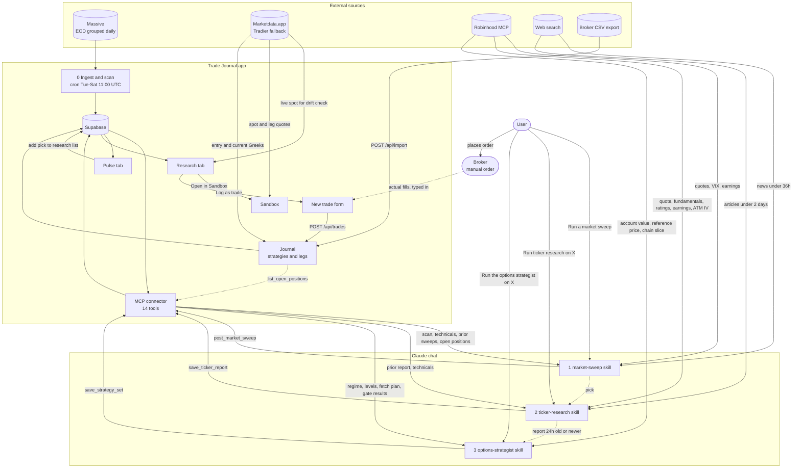
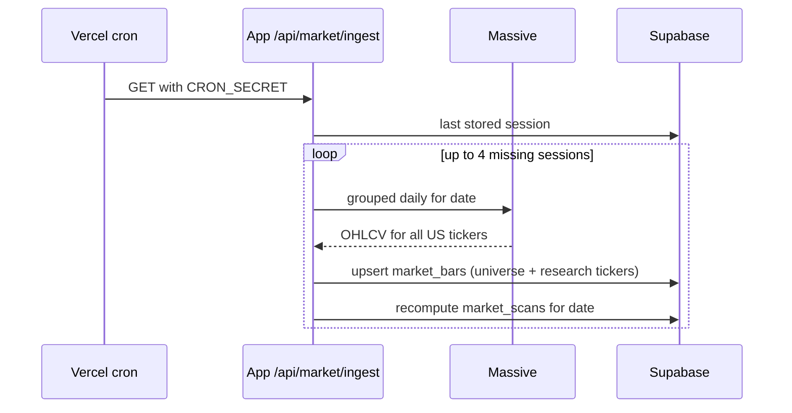
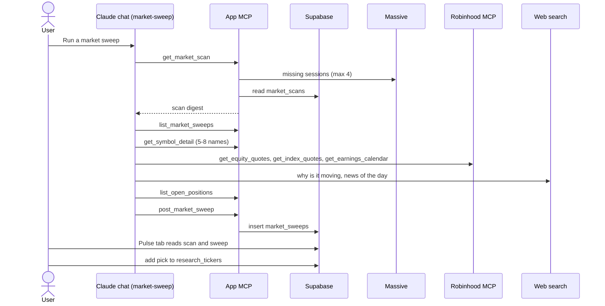
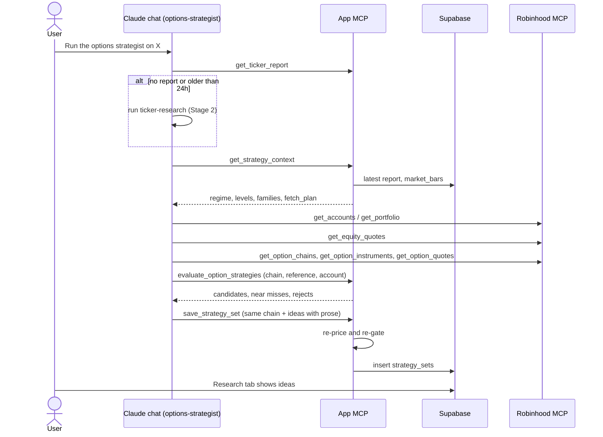

# Process flow: sweep → research → strategies → sandbox → registered trade

How an idea travels through the Trade Journal, who does each step (the **app**
or **Claude chat**), and which data source feeds it. Extracted from the code on
2026-11-11; file references are the source of truth if this drifts.

The diagrams are [Mermaid](https://mermaid.js.org) and render on GitHub as-is.
[Section 9](#9-machine-readable-graph) repeats the whole flow as a plain
node/edge list for any other visualization engine.

## 1. Actors and sources

| Id | Actor / source | Role | Used by | Where in code |
|---|---|---|---|---|
| `user` | The user | Triggers each stage with a prompt or a click; places real orders manually at the broker | — | — |
| `chat` | Claude chat (claude.ai) | Judgment: reads, picks, explains, writes back. Driven by three uploaded skills | — | `skills/*/SKILL.md` |
| `app` | Trade Journal (Next.js on Vercel) | Everything mechanical: ingest, scan, technicals, strategy pricing and gating, storage, UI | — | `app/`, `lib/` |
| `mcp` | App-hosted MCP connector (14 tools) | The only channel between Claude chat and the app | chat | `app/api/mcp/[token]`, `lib/mcp/server.ts` |
| `db` | Supabase Postgres + Auth | Storage, row-level security | app, browser | `supabase/migrations/` |
| `massive` | Massive (ex-Polygon) Grouped Daily, free Stocks Basic | End-of-day OHLCV for the whole US market, one call per session | app only | `lib/market-data/eod.ts` |
| `marketdata` | Marketdata.app (Tradier fallback) | Live-ish spot and per-contract option quotes with Greeks/IV; 1 credit per contract, 100/day free | app only | `lib/quotes.ts`, `lib/marketdata.ts` |
| `robinhood` | Robinhood MCP connector | Live equity/index quotes, fundamentals, analyst ratings, earnings calendar, option chains, account value | chat only | called from skills |
| `web` | Web search | Dated news: why a name moved, news of the day, company articles | chat only | called from skills |
| `universe` | `data/universe.json` | S&P 500 + Nasdaq-100 (518) + index/sector ETFs with sector/industry | app | `lib/universe.ts` |
| `csv` | Broker CSV exports (Robinhood, tastytrade, ThinkOrSwim, IBKR, generic) | Alternative way to register trades | app | `lib/importers/` |

Two rules shape everything below:

- **The deployed app never calls Robinhood, and Claude chat never calls Massive
  or Marketdata.** They meet only through the MCP connector and the database.
- **Nothing in this flow places an order.** The skills and the MCP server
  forbid it; "register to trade" means logging a trade in the journal after the
  user has placed it at the broker themselves.

## 2. End-to-end overview



## 3. Stage 0 — market data ingest and scan (app only)

Runs before any chat work and is what makes the sweep cheap.

| Step | What happens | Source | Writes |
|---|---|---|---|
| Trigger | Vercel cron `0 11 * * 2-6` → `GET /api/market/ingest` (`Bearer CRON_SECRET`); also the `get_market_scan` / `refresh_market_data` tools and `scripts/backfill-market.mjs` | — | — |
| Fetch | Missing sessions, oldest first, at most 4 per run (free tier: 5 calls/min) | Massive `GET /v2/aggs/grouped/locale/us/market/stocks/{date}` | — |
| Store | Only the universe plus every research ticker | `data/universe.json`, `research_tickers` | `market_bars` |
| Scan | `lib/market-scan.ts` recomputes the digest (~14 KB): breadth, index proxies, sector rotation, industries, index contributors, ≤ 25 anomalies | `market_bars` | `market_scans` |



## 4. Stage 1 — market sweep (Pulse tab)

Trigger: the user tells Claude chat "Run a market sweep" (the Pulse tab offers
the prompt to copy). Skill: `skills/market-sweep`. Budget: ~12–15 tool calls,
≤ 6 web searches.

| # | Step | Actor | Source and call | Output |
|---|---|---|---|---|
| 1 | Read the market | chat → app | MCP `get_market_scan` (tops up missing sessions from Massive first, then reads `market_scans`) | Breadth, sectors, industries, movers, anomalies |
| 2 | Context | chat → app | MCP `list_market_sweeps(limit 3)` ← `market_sweeps` | New vs persisting rotation |
| 3 | Choose 5–8 names | chat | Judgment over the scan (volume-confirmed anomalies first) | Shortlist |
| 4 | Detail | chat → app | MCP `get_symbol_detail` ← `market_bars` + `lib/technicals.ts` | SMA/RSI/MACD/ATR/HV, last 10 bars |
| 5 | Live prices | chat | Robinhood `get_equity_quotes`, `get_index_quotes` (VIX), optionally `get_earnings_calendar` — one batched call each | Current / after-hours price, VIX |
| 6 | Why is it moving | chat | Web search, last ~2 days only | Dated causes |
| 7 | News of the day | chat | Web search, last ~24 h | 5–8 headlines |
| 8 | Exposure | chat → app | MCP `list_open_positions` ← `strategies` + `legs` | Overlap with open trades |
| 9 | Publish | chat → app | MCP `post_market_sweep`; validated by `MarketSweepInputSchema` + `sweepProblems` (news ≤ 36 h vs `as_of`, no duplicates) | Row in `market_sweeps` |
| 10 | Display | app | Browser reads `market_scans`, `market_sweeps`, `research_tickers` (RLS) | `/pulse` |
| 11 | Hand-off | user | "Add" on a pick upserts `research_tickers` | Pick is on the research list |



## 5. Stage 2 — ticker research (Research tab)

Trigger: "Run ticker research on X" or "Refresh my research list" (prompts
offered on the Research tab), or automatically as the first step of the
options strategist. Skill: `skills/ticker-research`.

| # | Step | Actor | Source and call | Output |
|---|---|---|---|---|
| 1 | Which tickers | chat → app | MCP `list_research_tickers` ← `research_tickers` + latest report age (fresh ≤ 24 h, aging ≤ 4 d, stale, none) | Up to ~5 per turn |
| 2 | Prior view | chat → app | MCP `get_ticker_report` ← `ticker_reports`, `strategy_sets` | What changed |
| 3 | Technicals | chat → app | MCP `get_symbol_detail` ← `market_bars`; fallback Robinhood `get_equity_technical_indicators` when the app has no bars | Trend/momentum inputs |
| 4 | Snapshot | chat | Robinhood `get_equity_quotes`, `get_equity_fundamentals`, `get_equity_analyst_ratings`, `get_earnings_calendar` | Price, valuation, ratings, next earnings |
| 5 | IV (optional) | chat | Robinhood `get_option_chains` → `get_option_instruments` → `get_option_quotes` near 30 DTE, ATM | `iv` |
| 6 | News | chat | Web search, ≤ 5 articles from the last 2 days | `articles` |
| 7 | Rate and write | chat | Rubric in the skill: trend, momentum, volatility, risk + fundamentals paragraph | Report payload |
| 8 | Save | chat → app | MCP `save_ticker_report`; validated by `TickerReportInputSchema` + `tickerReportProblems`; sector/industry default from `data/universe.json` | Row in `ticker_reports`; ticker added to `research_tickers` |
| 9 | Display | app | Browser reads `research_tickers`, `ticker_reports`, `strategy_sets`, `market_bars` (price chart); `GET /api/research/spot` → Marketdata for the live header price | `/research?symbol=X` |

## 6. Stage 3 — options strategies (Research tab → Options strategies)

Trigger: "Run the options strategist on X". Skill: `skills/options-strategist`.
The split here is strict: **Claude supplies quotes and prose; the app computes
every risk number.**

| # | Step | Actor | Source and call | Output |
|---|---|---|---|---|
| 1 | Research gate | chat → app | MCP `get_ticker_report`; all three strategy tools refuse unless the ticker is on the research list with a report ≤ 24 h old (`FRESHNESS_HOURS.fresh`) | Runs Stage 2 first if missing or stale |
| 2 | Context | chat → app | MCP `get_strategy_context` ← latest report (ratings, IV, earnings) + `market_bars` (hv20, ATR, 20-session support/resistance and gap via `lib/levels.ts`) → selector in `lib/strategy-rules.ts` | Eligible families per horizon (short 0–3 DTE, long 4–21 DTE), `fetch_plan` |
| 3 | Account value | chat | Robinhood `get_accounts` / `get_portfolio` | `account_value_cents` |
| 4 | Reference price | chat | Robinhood `get_equity_quotes` | `reference_price_cents`, `reference_at` |
| 5 | Chain slice | chat | Robinhood `get_option_chains` → `get_option_instruments` → `get_option_quotes`, ≤ 160 contracts inside the planned strike band; fresh ≤ 30 min (short) / same day (long) | bid, ask, IV, delta, OI, volume |
| 6 | Evaluate | chat → app | MCP `evaluate_option_strategies` → `lib/strategy-catalog.ts` builds structures (+ ≤ 5 custom from Claude), `lib/strategy-economics.ts` prices at natural bid/ask and gates | ≤ 3 ranked candidates, near misses, reject counts. Nothing saved |
| 7 | Choose and explain | chat | Judgment + report/news context | rationale, catalysts, risks, exit plan |
| 8 | Save | chat → app | MCP `save_strategy_set` with the same chain; server re-prices, re-gates and stores its own numbers | Row in `strategy_sets` (latest per symbol wins); `ideas: []` + `no_setup_reason` when nothing clears |
| 9 | Display | app | Browser reads `strategy_sets`; staleness = quote age (30 min / 24 h) or drift > 0.5 ATR from the reference, using the Marketdata live spot | Ideas card with **Open in Sandbox** and **Log as trade** |

The gate (`STRATEGY_RULES`, all four required): max loss ≤ 3.25× max gain ·
expected P&L > 0 under 20-session realized volatility · one unit's max loss
≤ 50% of the account · survives a gap of max(largest 20-session gap, ATR14).



## 7. Stage 4 — sandbox (what-if, app only)

Page `/sandbox` (`app/sandbox/page.tsx`). Nothing is saved; all state is in the
browser. Claude chat is not involved.

| # | Step | Source and call | Output |
|---|---|---|---|
| 1 | Seed | "Open in Sandbox" on an idea builds `/sandbox?symbol=&spot=&legs=` (`sandboxHref` in `lib/strategy-ideas.ts`): the idea's legs at its sized quantity, natural fill prices and leg IV, spot = the set's reference price. All of it originally Robinhood data, as stored in `strategy_sets`. Legs can also be typed in by hand | Legs in the builder |
| 2 | Refresh spot (optional) | "Fetch" → `GET /api/sandbox/spot` → `fetchSpot()` → Marketdata `/stocks/quotes/{symbol}/` (Tradier fallback) | Current underlying price |
| 3 | Refresh legs (optional) | "Fetch Live Prices" → `POST /api/sandbox/quotes` → `fetchQuotes()` → Marketdata `/options/quotes/{occ}/`, one credit per leg; OCC built by `buildStorageOcc` | Leg price and IV overwrite the seeded ones |
| 4 | Model | Local Black-Scholes (`lib/pricing.ts`, r = 5%) | Payoff today / −7 d / −14 d / at expiry, decay curve, net and per-leg Greeks |
| 5 | Scenario | Spot slider (±25%) and days slider | Recomputed charts |

Note the two price bases: the idea is priced by the app from **Robinhood**
quotes Claude passed in; the sandbox refresh uses **Marketdata**, whose free
feed is delayed. A refreshed sandbox can therefore differ from the idea card.

## 8. Stage 5 — register the trade (journal)

The user places the order at the broker themselves, then logs it.

| # | Step | Actor | Source and call | Output |
|---|---|---|---|---|
| 1 | Prefill | app | "Log as trade" → `/trades/new?set={id}&idea={rank}`; `IdeaTradeForm` reads the `strategy_sets` row and `ideaToTradePrefill` fills underlying, strategy kind, legs at sized quantity and natural prices, and notes (label, rationale, exit plan) | Prefilled form with a warning to replace prices |
| 2 | Actual fills | user | Typed in from the broker confirmation | Entry prices |
| 3 | Save | app | `POST /api/trades` (Supabase JWT), validated by `StrategyInputSchema` | Rows in `strategies` (`source: manual`) and `legs` (money in integer cents) |
| 4 | Entry snapshot | app | `computeNetGreeks` → `fetchQuotes()` → Marketdata, best-effort | `entry_net_delta/gamma/theta/vega/iv` on the strategy |
| 5 | Monitor | app | "Refresh" → `GET /api/quotes?strategyId=` → Marketdata | Current value, min/max, current net Greeks |
| 6 | Manage / close | user → app | `PATCH /api/legs/{id}`, `PATCH /api/strategies/{id}` | Exit prices, realized P&L (`lib/calculations.ts`) |
| 7 | Feedback | chat → app | MCP `list_open_positions` in the next sweep | Exposure overlap flagged |

Alternative entry: `/trades/import` → `POST /api/import` parses a broker CSV
(`lib/importers/`) and groups fills into strategies (`source: csv_import`).

The link from idea to trade is the prefill only: the saved strategy keeps the
idea's label, rationale and exit plan in its thesis text, but no foreign key
back to the `strategy_sets` row.

## 9. Machine-readable graph

Self-contained description of the same flow for any diagram engine. `actor` is
who performs the edge; `source` is where the data on that edge comes from.

```yaml
nodes:
  - {id: user,        kind: person,   label: User}
  - {id: broker,      kind: external, label: Broker (manual order entry)}
  - {id: massive,     kind: source,   label: Massive EOD grouped daily,        used_by: app}
  - {id: marketdata,  kind: source,   label: Marketdata.app (Tradier fallback), used_by: app}
  - {id: robinhood,   kind: source,   label: Robinhood MCP,                    used_by: chat}
  - {id: web,         kind: source,   label: Web search,                       used_by: chat}
  - {id: csv,         kind: source,   label: Broker CSV export,                used_by: app}
  - {id: universe,    kind: source,   label: data/universe.json,               used_by: app}
  - {id: ingest,      kind: app,      label: Ingest and scan,                  stage: 0}
  - {id: mcp,         kind: app,      label: App MCP connector (14 tools)}
  - {id: db,          kind: store,    label: Supabase Postgres}
  - {id: sweep,       kind: chat,     label: market-sweep skill,               stage: 1}
  - {id: pulse,       kind: ui,       label: Pulse tab (/pulse),               stage: 1}
  - {id: tr,          kind: chat,     label: ticker-research skill,            stage: 2}
  - {id: os,          kind: chat,     label: options-strategist skill,         stage: 3}
  - {id: research,    kind: ui,       label: Research tab (/research),         stage: 2-3}
  - {id: sandbox,     kind: ui,       label: Sandbox (/sandbox),               stage: 4}
  - {id: tradeform,   kind: ui,       label: New trade form (/trades/new),     stage: 5}
  - {id: journal,     kind: app,      label: Journal (strategies + legs),      stage: 5}

edges:
  # Stage 0
  - {from: massive,    to: ingest,    actor: app,  label: grouped daily OHLCV, call: "GET /v2/aggs/grouped/locale/us/market/stocks/{date}"}
  - {from: universe,   to: ingest,    actor: app,  label: symbols to keep}
  - {from: ingest,     to: db,        actor: app,  label: market_bars, market_scans}
  # Stage 1
  - {from: user,       to: sweep,     actor: user, label: "Run a market sweep"}
  - {from: mcp,        to: sweep,     actor: chat, label: scan digest,        call: get_market_scan,     source: market_scans}
  - {from: mcp,        to: sweep,     actor: chat, label: prior sweeps,       call: list_market_sweeps,  source: market_sweeps}
  - {from: mcp,        to: sweep,     actor: chat, label: technicals,         call: get_symbol_detail,   source: market_bars}
  - {from: robinhood,  to: sweep,     actor: chat, label: "quotes, VIX, earnings", call: "get_equity_quotes, get_index_quotes, get_earnings_calendar"}
  - {from: web,        to: sweep,     actor: chat, label: "causes (2 days), news of the day (36 h)"}
  - {from: mcp,        to: sweep,     actor: chat, label: open positions,     call: list_open_positions, source: "strategies, legs"}
  - {from: sweep,      to: mcp,       actor: chat, label: publish sweep,      call: post_market_sweep,   writes: market_sweeps}
  - {from: db,         to: pulse,     actor: app,  label: "market_scans, market_sweeps"}
  - {from: pulse,      to: db,        actor: user, label: add pick,           writes: research_tickers}
  - {from: sweep,      to: tr,        actor: chat, label: pick to research,   optional: true}
  # Stage 2
  - {from: user,       to: tr,        actor: user, label: "Run ticker research on X"}
  - {from: mcp,        to: tr,        actor: chat, label: "list, prior report, technicals", call: "list_research_tickers, get_ticker_report, get_symbol_detail"}
  - {from: robinhood,  to: tr,        actor: chat, label: "quote, fundamentals, ratings, earnings, ATM IV", call: "get_equity_quotes, get_equity_fundamentals, get_equity_analyst_ratings, get_earnings_calendar, get_option_chains, get_option_instruments, get_option_quotes"}
  - {from: web,        to: tr,        actor: chat, label: "articles (2 days, max 5)"}
  - {from: tr,         to: mcp,       actor: chat, label: save report,        call: save_ticker_report,  writes: "ticker_reports, research_tickers"}
  - {from: db,         to: research,  actor: app,  label: "research_tickers, ticker_reports, market_bars"}
  - {from: marketdata, to: research,  actor: app,  label: live spot,          call: "GET /api/research/spot"}
  # Stage 3
  - {from: user,       to: os,        actor: user, label: "Run the options strategist on X"}
  - {from: tr,         to: os,        actor: chat, label: "report <= 24 h required", gate: true}
  - {from: mcp,        to: os,        actor: chat, label: "regime, levels, families, fetch plan", call: get_strategy_context, source: "ticker_reports, market_bars"}
  - {from: robinhood,  to: os,        actor: chat, label: "account value, reference price, chain slice (max 160 contracts)", call: "get_accounts, get_portfolio, get_equity_quotes, get_option_chains, get_option_instruments, get_option_quotes"}
  - {from: mcp,        to: os,        actor: chat, label: "gated candidates", call: evaluate_option_strategies}
  - {from: os,         to: mcp,       actor: chat, label: save ideas,         call: save_strategy_set,   writes: strategy_sets}
  - {from: mcp,        to: db,        actor: app,  label: validated writes}
  - {from: db,         to: research,  actor: app,  label: strategy_sets}
  # Stage 4
  - {from: research,   to: sandbox,   actor: user, label: Open in Sandbox,    call: "/sandbox?symbol=&spot=&legs="}
  - {from: marketdata, to: sandbox,   actor: app,  label: "spot, leg price and IV", call: "GET /api/sandbox/spot, POST /api/sandbox/quotes"}
  # Stage 5
  - {from: research,   to: tradeform, actor: user, label: Log as trade,       call: "/trades/new?set=&idea="}
  - {from: user,       to: broker,    actor: user, label: places order manually}
  - {from: broker,     to: tradeform, actor: user, label: actual fills typed in}
  - {from: tradeform,  to: journal,   actor: app,  label: create trade,       call: "POST /api/trades",  writes: "strategies, legs"}
  - {from: csv,        to: journal,   actor: app,  label: import fills,       call: "POST /api/import",  writes: "strategies, legs"}
  - {from: marketdata, to: journal,   actor: app,  label: "entry and current Greeks, value", call: "GET /api/quotes"}
  - {from: journal,    to: db,        actor: app,  label: "strategies, legs"}
  - {from: journal,    to: mcp,       actor: chat, label: exposure for next sweep, call: list_open_positions}
```

## 10. Storage map

| Table | Written by | Read by |
|---|---|---|
| `market_bars` | Stage 0 ingest (service role) | `get_symbol_detail`, `get_strategy_context`, Research price chart |
| `market_scans` | Stage 0 ingest | `get_market_scan`, Pulse tab |
| `market_sweeps` | `post_market_sweep` | Pulse tab, `list_market_sweeps` |
| `research_tickers` | `save_ticker_report`, `add_research_ticker`, Pulse "add pick", Research tab | Research sidebar, ingest (extra symbols), research gate |
| `ticker_reports` | `save_ticker_report` | Research tab, `get_ticker_report`, strategy tools |
| `strategy_sets` | `save_strategy_set` | Research ideas card, `IdeaTradeForm`, `get_ticker_report` |
| `strategies`, `legs` | `/api/trades`, `/api/import`, `/api/legs`, `/api/strategies`, `/api/quotes` | Dashboard, trades pages, `list_open_positions` |
| `mcp_tokens` | `/api/research/token` (sha256 of the connector secret) | `/api/mcp/[token]` |
