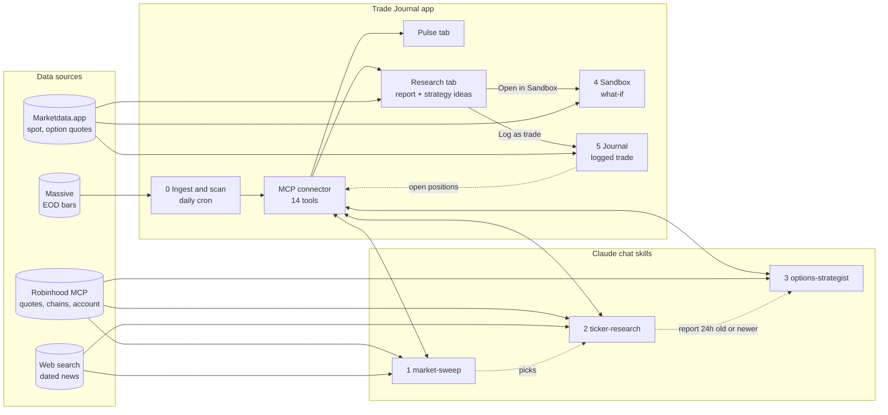

# Trade Journal

Personal options trading journal. It logs multi-leg option strategies and
tracks their performance, scans the market every day, and stores the research
and options strategy ideas that Claude chat produces from that scan.

**Stack:** Next.js 16 (App Router) · React 19 · TypeScript · Tailwind 4 · Supabase (Postgres + Auth) · TanStack Query · Zod · Recharts · Vitest

## How it works

The app does everything mechanical (ingest, scan, technicals, strategy pricing
and gating, storage, UI). Claude chat does the judgment, using the user's
Robinhood connector and web search, and writes back through the app's own MCP
connector. Nothing here places an order: a trade is logged after the user has
placed it at the broker.



**[PROCESS_FLOW.md](PROCESS_FLOW.md)** has the full picture: every step of each
stage, who performs it, the exact call and data source behind it, sequence
diagrams, and a machine-readable node/edge list.

## Setup

1. Install dependencies: `npm install`
2. Copy `.env.example` to `.env.local` and fill it in:

   | Variable | Needed for |
   |---|---|
   | `NEXT_PUBLIC_SUPABASE_URL`, `NEXT_PUBLIC_SUPABASE_ANON_KEY`, `SUPABASE_SERVICE_ROLE_KEY` | Everything |
   | `MARKETDATA_API_TOKEN` | Option quotes, Greeks and spot prices (free plan: 100 credits/day, one credit per contract) |
   | `TRADIER_API_TOKEN` | Optional fallback when no Marketdata token is set; needs a funded Tradier account |
   | `MARKET_DATA_PROVIDER` | Optional: force `marketdata` or `tradier` |
   | `MASSIVE_API_KEY` | End-of-day bars for the market scan (free Stocks Basic plan) |
   | `CRON_SECRET` | Authorises the daily ingest cron and the backfill script |

3. Apply the database migrations (`supabase/migrations/0001`–`0009`):
   ```bash
   npx supabase link --project-ref YOUR_PROJECT
   ```
   ```bash
   npx supabase db push
   ```
4. For Research and Pulse (market data backfill, connecting Claude chat,
   uploading the skills), follow [skills/README.md](skills/README.md).

## Development

```bash
npm run dev     # dev server on localhost:3000
npm test        # Vitest
npm run lint    # ESLint + TypeScript check
npm run build   # production build
```

Use `npm`, not `pnpm`. Run `npm run lint` and `npm test` after any change to
`lib/` or `app/api/`.

## Features

### Trade journal (`/`, `/trades`)
- **Strategies**: single- and multi-leg option strategies with Greeks
  snapshots at entry, on refresh and at close
- **Manual entry** at `/trades/new`; add, edit, close and delete legs and
  strategies from the detail page. The form can be prefilled from a strategy
  idea ("Log as trade" on the Research tab)
- **CSV import** at `/trades/import`: tastytrade, ThinkorSwim, IBKR and
  Robinhood parsers; Schwab and Fidelity use the generic parser with column
  mapping. Fills are grouped into strategies and deduplicated by
  `external_group_ref`
- **Live data**: on-demand quotes and Greeks per leg through Marketdata.app
  (Tradier fallback), with min/max value tracking and a "Refresh All" button.
  Missing Greeks are flagged and left out of net Greeks rather than counted as
  zero
- **Dashboard**: total and realized/unrealized P&L, win rate, average
  win/loss, max drawdown, average hold, equity curve, recent strategies
- All times display in US Central (`America/Chicago`), 24-hour clock

### Market Pulse (`/pulse`)
- **EOD ingest**: Massive Grouped Daily, one call per session for the whole US
  market; daily Vercel cron (`0 11 * * 2-6` UTC) plus a resumable backfill
  script
- **Market scan** computed in code from stored bars: breadth, index proxies,
  sector rotation, industries, index contributors, and up to 25 anomalies with
  reason codes (`REL_VOL`, `RET_Z`, `GAP`, `NEW_HIGH`/`NEW_LOW`,
  `SECTOR_DIVERGENCE`, `QUIET_ACCUMULATION`, `STREAK`)
- **Universe**: S&P 500 + Nasdaq-100 (518 names) plus index and sector ETFs in
  `data/universe.json`
- **Sweeps** written by the `market-sweep` skill: headline, regime,
  highlights, picks, trends, and up to 8 news headlines no older than 36 h

### Research (`/research`)
- **Research list** grouped by sector, industry or setup, with report
  freshness (fresh ≤ 24 h, aging ≤ 4 days, stale)
- **Ticker reports** written by the `ticker-research` skill: snapshot numbers,
  trend / momentum / volatility / risk ratings, a fundamentals paragraph, and
  up to 5 articles from the last 2 days
- **Charts**: price with SMA 20/50/200, volume, RSI 14 and MACD, with a synced
  crosshair and a readout strip
- **Glossary bubbles** explain technical terms on hover, focus or tap
- **Connect Claude**: generates the per-user MCP connector URL (revocable)

### Options strategies (Research tab)
- **Research first**: the strategy tools refuse a ticker without a report
  ≤ 24 h old
- **15 strategy families**: credit and debit verticals, iron condor, iron
  butterfly, long and broken-wing butterflies, jade lizard, 1×2 put ratio,
  cash-secured put, calendar, diagonal, double diagonal; plus up to 5 custom
  structures per evaluation
- **Economics computed by the app** from the quotes Claude passes: natural
  bid/ask pricing, max gain and loss, breakevens, probability of profit and
  expected P&L under realized and implied volatility, theta, gap test, sizing
- **Gate** (all required): max loss ≤ 3.25× max gain · expected P&L > 0 under
  realized volatility · one unit's max loss ≤ 50% of the account · survives a
  recent-size gap
- Up to 3 ideas, one per family, each with a payoff chart, a stale badge, and
  "Log as trade" / "Open in Sandbox" actions
- Horizons: short 0–3 DTE and long 4–21 DTE. Position management (scale-out,
  roll, review) is planned as Phase 11b in `PROGRESS.md`

### Strategy sandbox (`/sandbox`)
- Multi-leg builder, seeded from a strategy idea or typed in by hand
- Black-Scholes pricing and Greeks (`lib/pricing.ts`), computed in the browser
- Payoff diagram (today, −7 d, −14 d, at expiry), theta decay curve, net and
  per-leg Greeks, spot and days sliders
- Optional live spot and leg prices through Marketdata.app

### MCP connector (`/api/mcp/[token]`)
- 14 tools, stateless Streamable HTTP; the path segment is a per-user secret
  and only its hash is stored
- Every write is validated with Zod and cross-field checks; a bad payload
  comes back as a tool error, never coerced
- The server cannot trade

### Auth, theme, deployment
- Supabase Auth: login, signup, forgot/reset password, protected routes;
  row-level security on user data
- Light / dark / system theme
- Deployed on Vercel

## Project layout

- `app/` — pages (`/`, `/trades`, `/pulse`, `/research`, `/sandbox`) and API
  routes (`/api/trades`, `/api/legs`, `/api/strategies`, `/api/quotes`,
  `/api/import`, `/api/sandbox/*`, `/api/research/*`, `/api/market/ingest`,
  `/api/mcp/[token]`)
- `components/` — React components (`ui/`, `pulse/`, `research/`, `sandbox/`,
  `strategy-detail/`)
- `lib/` — calculations, schemas, quotes, OCC symbols, pricing, technicals,
  market ingest and scan, strategy rules / catalog / economics / engine, MCP
  server, research store
- `lib/importers/` — broker CSV parsers and fill grouping
- `data/universe.json` — scan universe
- `scripts/` — `backfill-market.mjs`, `refresh-universe.mjs`,
  `smoke-marketdata.mjs`
- `skills/` — Claude chat skills: `market-sweep`, `ticker-research`,
  `options-strategist`
- `supabase/migrations/` — SQL schema

## Further reading

- [PROCESS_FLOW.md](PROCESS_FLOW.md) — the sweep → research → strategies →
  sandbox → trade flow and its data sources
- [skills/README.md](skills/README.md) — Research and Pulse setup checklist
- [OCC_SYMBOLOGY.md](OCC_SYMBOLOGY.md) — read before touching option symbol code
- [PROGRESS.md](PROGRESS.md) — phase-by-phase progress
- [CLAUDE.md](CLAUDE.md) — conventions and gotchas
- `reports/` — provider research (Robinhood MCP vs Tradier, free options data APIs)
